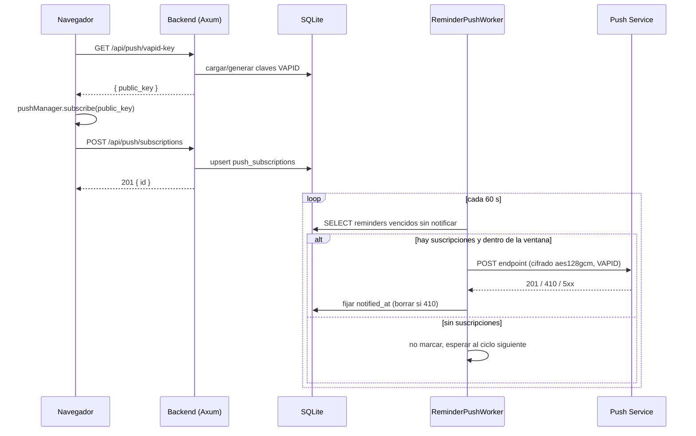

# Design

## Arquitectura y flujo

Tres piezas: el navegador (service worker + gestor de suscripción), el backend HTTP (claves VAPID y
suscripciones) y el `ReminderPushWorker`. El flujo completo, de la suscripción al aviso:

## Por qué el worker y no un endpoint de prueba

La capa proactiva se retiró porque no entregaba nada. La pregunta útil no es «¿funciona la
criptografía?», sino «¿llega el aviso de un recordatorio real?». Un `POST /api/push/test` verificaría
solo lo primero. El `ReminderPushWorker` verifica el comportamiento completo —selección, ventana,
envío y marca— sobre el único caso que importa: un recordatorio que vence. Por eso queda fuera de
alcance el endpoint de prueba.

## Por qué la clave VAPID vive en `settings` y se genera sola

Las claves VAPID no son un secreto de despliegue que el operador deba copiar: son un par por
instalación que puede generarse en el arranque. Guardarlas en `settings` las hace persistentes sin
añadir variables de entorno ni ficheros. El problema real es la concurrencia: si dos peticiones
llegan a la vez, cada una podría generar un par distinto y suscribir un cliente con la clave
perdedora, de modo que el envío firmaría con una clave que el Push Service rechazaría. La
transacción con `INSERT ... ON CONFLICT(key) DO NOTHING` seguido de un `SELECT` de las dos claves
resuelve esto: gana la primera que escribe, y la segunda converge leyendo el par ya persistido. La
privada se trata como material sensible —`SENSITIVE_KEYS`— y no sale nunca en un log ni en una
respuesta.

## Por qué se inyecta el `PushSender`

El worker no puede probarse contra un Push Service real en la suite de Rust. Si construyera el
cliente HTTP por dentro, cada test necesitaría red. Con una abstracción `PushSender` inyectada, los
tests sustituyen el transporte por un doble que registra las llamadas y devuelve los códigos que se
quieren ejercitar (`410`, `500`, éxito). El worker se prueba entero —selección, ventana, marca— sin
tocar la red.

## Los formatos de fecha de `reminders`

`reminders.datetime` se guarda en **RFC 3339** (`…T…Z`, y los snoozeados con `+00:00`), mientras que
`datetime('now')` de SQLite devuelve `… …` **con espacio**. Comparar esas cadenas en SQL es
silenciosamente incorrecto: `'T'` (0x54) es mayor que `' '` (0x20), así que el orden lexicográfico de
una fecha RFC 3339 frente a la forma con espacio no refleja el orden temporal. Por eso la selección
**no filtra por fecha en SQL** —solo por `status='pending'` y `notified_at IS NULL`— y la comparación
de vencimiento, junto con la ventana de gracia, se hace **en Rust** con
`chrono::DateTime::parse_from_rfc3339`, que acepta las dos formas. Un test fija ese comportamiento:
`z_and_offset_datetimes_compare_correctly`.

## Riesgos residuales

1. **`web-push-native` es una crate joven** (`superboring`, `ece-native`), con menos rodaje que
   `web-push`. Mitigación: un test de contrato que verifica el formato RFC 8291 sin red (offsets del
   cuerpo y cabeceras) y una verificación de punta a punta con un navegador real.
2. **La entrega solo ocurre con el servidor en marcha.** Si el servidor está caído cuando vence el
   recordatorio, se entrega al arrancar si sigue dentro de la ventana; si no, se descarta con un
   aviso. La ventana de gracia es exactamente ese compromiso: no perder lo reciente, no inundar con
   lo viejo.
3. **La entrega es como máximo una vez por recordatorio, pero el Push Service puede duplicar.** El
   `tag` del payload hace que dos avisos del mismo recordatorio se reemplacen en lugar de apilarse,
   pero no elimina la duplicación en origen.
4. **El service worker no se puede probar con vitest.** No hay DOM de service worker en jsdom; solo
   se verifica en un navegador real. Por eso el diseño lo mantiene mínimo —sin handler de `fetch`—
   y concentra en TypeScript la parte testeable (la conversión base64url y el gestor de suscripción).
5. **WebPush exige HTTPS.** `co1` va tras Traefik con TLS; en desarrollo `localhost` es un origen
   seguro y basta.
